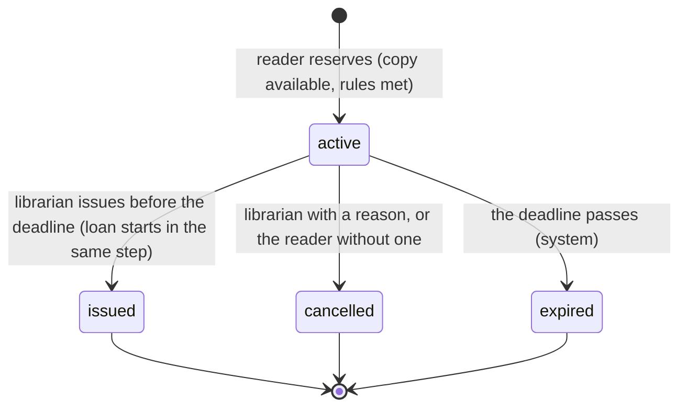

# Data Model: Close the Priority Technical Debt of v1.0

**Plan**: [plan.md](plan.md) | **Research**: [research.md](research.md)

This feature adds two tables: reservations (PR 4) and audit entries (PR 8). It changes rules on
three existing models. It also adds three records that live outside the database: backup files,
the restore record and the debt register. Every schema change is a Django migration generated by
`makemigrations`, and no migration that has reached `main` is edited (Principle V).

## 1. Reservation (new, `order` app, PR 4)

A reader's 48-hour hold on one unit of a book's stock (FR-008), not on a particular copy.

| Field | Type | Rules |
|---|---|---|
| `id` | `BigAutoField` | Project default |
| `user` | FK `CustomUser`, `CASCADE`, `related_name="reservations"` | The reader. Deleting the account deletes its reservations, so they stop holding copies. Their audit entries remain (spec edge case). |
| `book` | FK `Book`, `PROTECT`, `related_name="reservations"` | A book with reservation history cannot be deleted (FR-024) |
| `state` | `CharField(16)`, choices `active`, `issued`, `cancelled`, `expired`; default `active` | Stored state; see [Effective state](#effective-state) |
| `created_at` | `DateTimeField`, default `timezone.now`, not editable | Set once |
| `expires_at` | `DateTimeField` | `created_at` + 48 hours, set once (FR-010) |
| `loan` | `OneToOneField(Order)`, `SET_NULL`, nullable, `related_name="reservation"` | The loan the reservation became when issued. Set to null if that loan is later deleted; the audit trail keeps the link. |
| `cancelled_by` | FK `CustomUser`, `SET_NULL`, nullable, `related_name="+"` | Who cancelled it: a librarian, or the reader themselves |
| `cancelled_at` | `DateTimeField`, nullable | When it was cancelled |
| `cancel_reason` | `CharField(500)`, blank | Required, 1 to 500 characters, when someone other than the reader cancels (FR-017) |
| `cancellation_seen_at` | `DateTimeField`, nullable | When the reader dismissed the library's cancellation notice (PR 6, R15) |

**Constraints** (PR 4):

| Name | Rule |
|---|---|
| `reservation_lasts_48_hours` | `CHECK (expires_at = created_at + interval '48 hours')` |
| `one_active_reservation_per_reader_and_book` | Unique `(user, book)` where `state = 'active'`. A backstop; the service checks first, and expires due reservations under its locks (R11). |
| `cancelled_reservation_has_time` | `state <> 'cancelled' OR cancelled_at IS NOT NULL` |

**Indexes**:
- `(book, state, expires_at)`, for availability;
- `(user, state)`, for the limit and the reader's list;
- `(state, expires_at)`, for the desk list and the expiry task.

**Bulk writes**: `ReservationQuerySet.update()`, `bulk_update()` and `bulk_create()` refuse to set
`state`, `loan` or any `cancel*` field. Every change of state goes through `order/services.py`
(R13).

### Effective state

A stored `active` reservation whose `expires_at` is at or before now is expired, whether or not the
scheduled task has marked it yet (FR-013). Every availability check, eligibility check, page and API
response uses the effective state.

### States and transitions (FR-014)



- Issued, cancelled and expired are final. Any other transition raises an error, and nothing
  changes.
- **The deadline**: the reservation can be issued only while `now < expires_at`. At exactly 48
  hours it is expired, and the check runs again when the issue commits (spec edge cases).
- **Until PR 6**: readers may still lend to themselves (FR-003, FR-061). A reader's own loan of a
  book they have reserved issues that reservation (R13). PR 6 removes the reader's path, and from
  then on only librarians issue.

### Rules that read reservations (FR-012, one implementation in `order/services.py`)

| Rule | Counts |
|---|---|
| A copy is available | `count` − active loans − effectively active reservations > 0 |
| One reservation per book | The reader has no effectively active reservation of the book |
| Not already on loan | The reader has no active loan of the book |
| At most 3 | The reader has fewer than 3 effectively active reservations |
| No overdue loan | The reader has no loan with `end_at IS NULL AND plated_end_at < now` |

## 2. Loan (`order.Order`, existing)

| Change | PR | Detail |
|---|---|---|
| `book` uses `on_delete=PROTECT` (was `CASCADE`) | 4 | State-only migration. Today the API and the admin site delete a book's loans with the book; afterwards no channel can (R10). |
| Who starts a loan | 1, 6 | PR 1: librarians, or a reader for themselves (FR-003). PR 6: librarians only, through `lend()` or `issue()`. |
| Overdue | 5 | A derived condition, not a field: `end_at IS NULL AND plated_end_at < now`. It blocks reserving and issuing, but not corrections (spec edge case). |
| Audit entries | 8 | `Order.save()` writes `loan_started`, `loan_returned`, `loan_reopened` and `loan_reassigned` inside its atomic block. A `post_delete` receiver writes `loan_deleted`. |
| Bulk writes | 8 | `OrderQuerySet.update()` refuses `end_at`, `book` and `user`, and `bulk_create()` is refused, because both would bypass the copy check and the audit entry |

The loan keeps today's fields: `created_at` (start), `plated_end_at` (due) and `end_at` (returned).
The loan period stays 1 to 30 days, 14 by default.

## 3. Book stock (`book.Book`, existing)

| Change | PR | Detail |
|---|---|---|
| `count` must be 0 or more | 3 | `MinValueValidator(0)`, enforced by the form, the API and the admin site. State-only migration `book/0005` (R9). |
| Availability includes reservations | 5 | `with_availability(now)` adds `active_reservation_count`, and `available_count` = `count` − active loans − effectively active reservations, never below 0 (FR-009, R12) |
| Deletion | 4 | Refused while any loan or reservation exists, in every channel, because the foreign keys use `PROTECT` |
| Audit entries | 8 | `Book.save()` writes `book_copies_changed` when `count` changes. A `post_delete` receiver writes `book_deleted`. |
| Bulk writes | 8 | `BookQuerySet.update()` refuses `count`, as it already refuses `name` and `description` |

The available number is never stored (KAN-18).

## 4. Account and role (`authentication.CustomUser`, existing)

| Value | Label | Rights |
|---|---|---|
| `ROLE_VISITOR = 0` | "visitor"; PR 11 relabels it "reader" | Reads the catalog, their own account (and changes its names), their own loans and reservations |
| `ROLE_LIBRARIAN = 1` | "librarian" | Every operation. Until PR 11, also grants and removes the librarian role. |
| `ROLE_ADMINISTRATOR = 2` (PR 11) | "administrator" | Every librarian right, and the only role that grants or removes the librarian role (FR-063) |

| Change | PR | Detail |
|---|---|---|
| Registration always creates a reader | 1 | The form has no role or status field, and a posted one is ignored (FR-001) |
| One rule for role and status changes | 1, 11 | `authentication/services.py`: `may_change_role`, `may_change_status` and `update_account` (R3, R26) |
| One predicate for librarian rights | 1, 11 | `is_librarian`. From PR 11 it is true for librarians and administrators. `is_administrator` is new. |
| `created_at` set once | 3 | `auto_now_add=True` replaces `auto_now=datetime.datetime.now()`, which behaved as `auto_now` (R9). State-only migration `authentication/0004`. |
| Audit entries | 8 | `save()` becomes atomic and writes `role_granted`, `role_removed`, `account_activated` and `account_deactivated`, comparing with the locked row. A `post_delete` receiver writes `account_deleted`. |
| Bulk writes | 8 | A queryset refuses `update()` of `role` and `is_active` |
| Administrator role | 11 | New choice and labels in a state-only migration `authentication/0005`. `createsuperuser` creates an administrator, and `set_administrator` changes an existing account. |

## 5. Audit entry (new, `audit` app, PR 8)

An unchangeable record of one critical change (FR-037, FR-038).

| Field | Type | Rules |
|---|---|---|
| `id` | `BigAutoField` | |
| `occurred_at` | `DateTimeField`, default `timezone.now`, indexed | For `reservation_expired`, the reservation's deadline |
| `actor_id` | `PositiveBigIntegerField`, nullable | The account that made the change; null for the system. Not a foreign key, so it survives deletion. |
| `actor_label` | `CharField(150)` | "First Last (#12)", or "system" |
| `action` | `CharField(32)`, choices below | |
| `target_type` | `CharField(16)`, choices `account`, `loan`, `reservation`, `book` | |
| `target_id` | `PositiveBigIntegerField` | |
| `target_label` | `CharField(200)` | For example, "Dune" or "Loan #5: Dune (Jane Doe #12)" |
| `before` | `JSONField`, default `{}` | Only the fields that changed |
| `after` | `JSONField`, default `{}` | Only the fields that changed |
| `reason` | `CharField(500)`, blank | Required for a library cancellation |
| `channel` | `CharField(8)`, choices `web`, `api`, `admin`, `command`, `system` | `system` is the scheduled expiry and other background work, where the actor is the system |
| `request_id` | `CharField(64)`, blank | Links the entry to the technical log lines (R18) |

**Actions** (FR-037):

| Target | Actions |
|---|---|
| Account | `role_granted`, `role_removed`, `account_activated`, `account_deactivated`, `account_deleted` |
| Loan | `loan_started`, `loan_returned`, `loan_reopened`, `loan_reassigned`, `loan_deleted` |
| Reservation | `reservation_created`, `reservation_issued`, `reservation_cancelled`, `reservation_expired` |
| Book | `book_copies_changed`, `book_deleted` |

**Rules**:
- **Written with the change**: `audit.services.record()` runs inside the change's transaction. If
  the insert fails, the change rolls back (FR-040). An entry is never written for a change that
  rolls back.
- **Never changed**: `save()` refuses updates. `delete()`, and the queryset's `update()` and
  `delete()`, refuse. The admin site grants no add, change or delete permission, and no API exposes
  entries (FR-038).
- **Readable only by librarians**: through the admin site, which only librarians reach.
- **No secrets**: `before` and `after` never hold passwords, hashes, tokens or search text (FR-039).
- **Indexes**: `(target_type, target_id)`, `(occurred_at)` and `(actor_id, occurred_at)`.

## 6. Technical log line (PR 8)

```text
<UTC time, ms> <LEVEL> <service> <request id or -> <logger>: <message>
```

- `service` is `web`, `worker` or `backup`.
- Every continuation line of a traceback repeats the header, followed by `| `.
- Redaction, levels and rotation are in
  [contracts/logs-and-audit.md](contracts/logs-and-audit.md).

## 7. Backup files (PR 9, outside the database)

| Item | Rule |
|---|---|
| Location | The `pgbackups` volume, mounted at `/backups` in the `backup` service. Separate from `pgdata18`. |
| Name | `library-YYYYMMDDTHHMMSSZ.dump` (PostgreSQL custom format), plus `library-…dump.sha256` |
| Content | The whole `library_db`: accounts, roles, authors, books, vectors, loans, reservations, audit entries and analytics events, from one snapshot (FR-025) |
| Check | After writing: `pg_restore --list` and a full read with `pg_restore --file=/dev/null` |
| Retention | Delete only files older than `BACKUP_KEEP_DAYS` (7) that are not among the 7 newest (FR-026) |
| Access | Mode 600, owned by root. Never in the repository or the image (FR-028). |
| Copies | Weekly, the newest file and its checksum go to another machine, which keeps the last 4 (R23) |

Details are in [contracts/backups.md](contracts/backups.md).

## 8. Restore record (PR 9, documentation)

One entry per rehearsal, in research.md's Measurements and later in the register:
- the date and the operator;
- the backup file and its size;
- how long the restore took;
- the record counts compared, with the result;
- the librarian sign-in and search results;
- the peak memory during the rehearsal.

## 9. Debt item (PR 12, documentation)

One row of `docs/shared/debt-register.md`. It holds:
- an identifier, a description and the source;
- the priority (P1, P2 or P3) and the owner, named as a person;
- the status: closed, open, blocked or accepted;
- the evidence, the plan with a target sprint, or the blocker.

The rules are in [contracts/debt-register.md](contracts/debt-register.md).

## 10. Migrations by pull request

| PR | Migration | Operation | Effect on existing rows |
|---|---|---|---|
| 3 | `authentication/0004_alter_customuser_created_at` | `created_at`: `auto_now_add=True` | None (state only) |
| 3 | `book/0005_alter_book_count` | `count`: `MinValueValidator(0)` | None (state only). Before deploying, check that no book has a negative count. |
| 4 | `order/0004_reservation` | Create `Reservation` with its constraints and indexes; `Order.book` uses `on_delete=PROTECT` | None: a new table, and `on_delete` lives in Python (FR-022) |
| 8 | `audit/0001_initial` | Create `AuditEntry` | None |
| 11 | `authentication/0005_alter_customuser_role` | Choices add `(2, "administrator")` and relabel `0` as "reader" | None (state only) |

Migration numbers assume the recommended merge order (R1). If a migration in the same app merges
first, regenerate yours so it depends on the one that merged.
